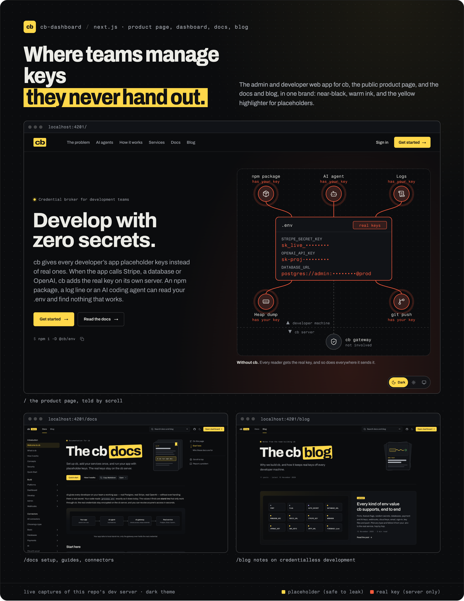
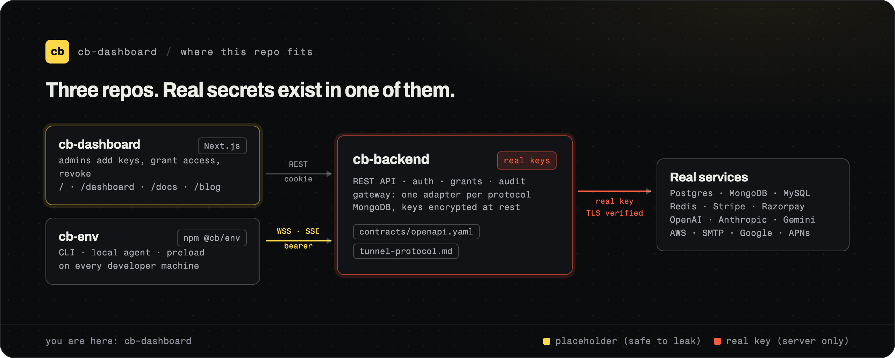

# cb-dashboard

<p align="center"></p>

The admin and developer web app for cb, where teams manage projects, variables, access and devices — and the home of the cb documentation.

**Documentation:** the dashboard serves the docs at `/docs`; their source is in [`content/docs/`](content/docs)
of this repository (gdhyani/cb-dashboard).

## What's in this app

| Route | What it is |
|---|---|
| `/` | Public product page, told by scroll (GSAP + Lenis) |
| `/dashboard` | Admin and developer app: projects, variables, access, devices, webhooks, audit |
| `/docs` | Documentation (Fumadocs, MDX in `content/docs/`) |
| `/blog` | Notes on credentialless development |

The dashboard never holds or receives a real secret: it talks to cb-backend over REST, and protected values are never readable.

<p align="center"></p>

## Run

```bash
npm install
npm run dev        # http://localhost:4201 — /api/* is proxied to CB_API_URL (default http://localhost:4200)
```

## Scripts

| Script | What it does |
|---|---|
| `npm run dev` / `npm run build` / `npm start` | Next.js dev server, production build, production server (port 4201) |
| `npm test` | Vitest + Testing Library, plus docs checks (links, images, secrets) |
| `npm run typecheck` / `npm run lint` | TypeScript / Biome |
| `npm run sync:contract` | Regenerate API types from `../cb-backend/contracts/openapi.yaml` |
| `npm run docs:images` | Frame raw screenshots from `docs-images-raw/` into `public/docs/images/` |

## Conventions

- Feature-based folders under `src/features/`; shared building blocks under `src/shared/` — reuse, never duplicate.
- All HTTP goes through `src/shared/api/http.ts` (axios) and TanStack Query hooks.
- API envelope and error shape are shared with the backend; errors surface `code` and `correlationId`.
- Docs pages are MDX under `content/docs/` (sidebar order in each folder's `meta.json`); framed screenshots
  live in `public/docs/images/`.

## Contributing

Contributions are welcome. Read [CONTRIBUTING.md](CONTRIBUTING.md) before opening a pull request, and report
vulnerabilities privately as described in [SECURITY.md](SECURITY.md).

## License

Licensed under the [Apache License 2.0](LICENSE). See [NOTICE](NOTICE).
